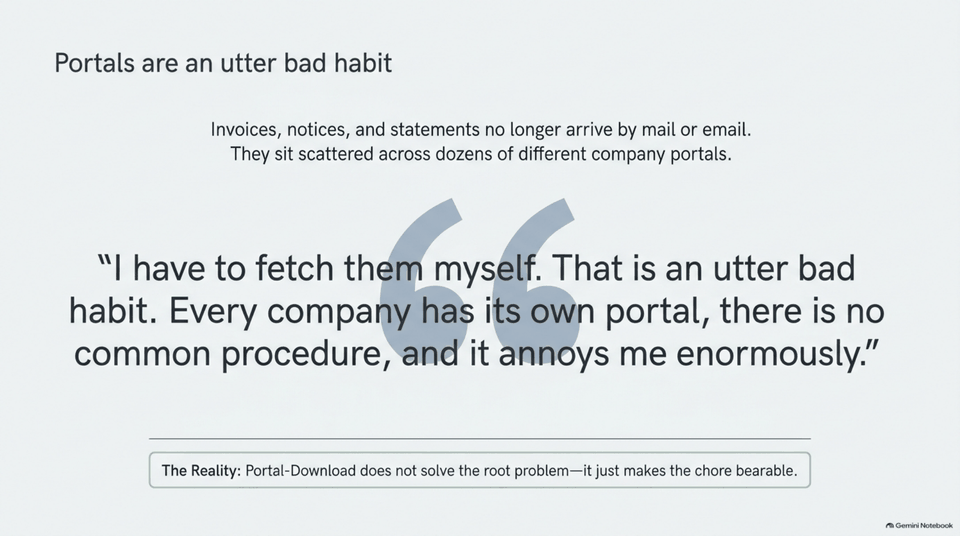
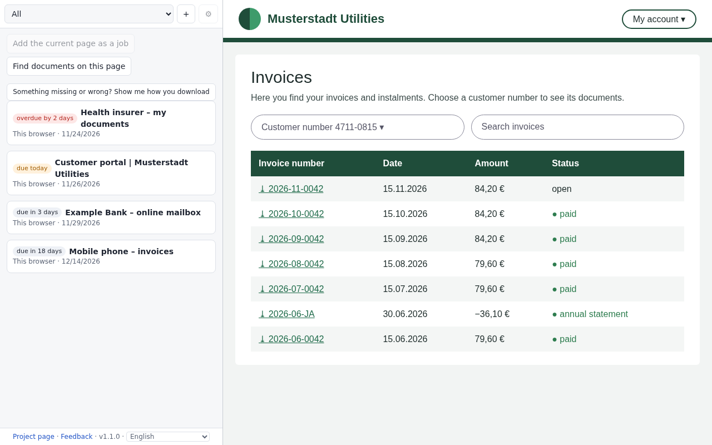

# Portal-Download browser extension

> [!IMPORTANT]
> **Warum es das gibt.** Rechnungen, Bescheide und Abrechnungen kommen bei vielen Unternehmen nicht mehr per Post oder E-Mail, sondern liegen nur noch in einem Portal, aus dem ich sie mir selbst holen muss. Das ist eine absolute Unart. Jedes Unternehmen hat sein eigenes Portal, ein einheitliches Verfahren gibt es nicht, und der einzige Grund, den ich mir dafür vorstellen kann, ist die Einbildung, so ließe sich die Zustellung beweisen. Mich nervt das gewaltig. portal-download löst das Problem nicht, es macht es für mich nur erträglicher, und zufrieden bin ich damit nicht. Die [GitHub-Diskussionen](https://github.com/schlingensiepen/portal-download-extension/discussions) sind offen und werden gelesen: Tragt dort bitte Erfahrungen, Wünsche, Verbesserungsvorschläge und Bugs ein. Wie die Erweiterung funktioniert, erklärt das [Benutzerhandbuch](https://github.com/schlingensiepen/portal-download-extension/wiki/Benutzerhandbuch) im Wiki.

> [!NOTE]
> **Why this exists.** Invoices, notices and statements from many companies no longer come by post or e-mail; they sit in a portal, and I have to fetch them myself. That is an utter bad habit. Every company has its own portal, there is no common procedure, and the only reason I can think of is the belief that this proves delivery. It annoys me enormously. portal-download does not solve the problem; it only makes it bearable for me, and I am not happy with it. The [GitHub discussions](https://github.com/schlingensiepen/portal-download-extension/discussions) are open and read: please post your experience, wishes, suggestions and bugs there. How the extension works is explained in the [user manual](https://github.com/schlingensiepen/portal-download-extension/wiki/User-Manual) in the wiki.

*Auf Deutsch: [die Folien als GIF](store/deck-de.gif). The full manual is in the [wiki](https://github.com/schlingensiepen/portal-download-extension/wiki).*

The extension shows your due portal downloads in one list in the browser's side panel. The portal opens in a normal tab beside it. You copy the login with one click, let the extension find the documents in the portal page and download them one after the other, and close the run as succeeded or failed.

It works in two ways, also both at once:

- **Without any server:** the jobs are kept in this browser only, in an encrypted **local store**.
- **With a [Portal-Download](https://github.com/schlingensiepen/portal-download) service:** a small circle of people shares one list of jobs. Somebody in the circle runs the service.

A **backend** is one source of jobs: a service, or the local store. A **job** is one portal with its login and its schedule. The [glossary](https://github.com/schlingensiepen/portal-download/blob/main/docs/glossary.md) explains the other words.

The extension is for Chrome and Edge 121 or newer, and Firefox 140 or newer.

## Installing

**Firefox:** install it from its page on addons.mozilla.org: <https://addons.mozilla.org/firefox/addon/0ddcaa2ae78346fdb5cc/>, and click *Add to Firefox* there. To try a newer version before it is there, Firefox can load it for the current session only:

1. Download `portal-download-<version>.zip` from a [release](https://github.com/schlingensiepen/portal-download-extension/releases) and unpack it.
2. Open `about:debugging#/runtime/this-firefox`.
3. Click *Load Temporary Add-on…* and choose the file `manifest.json` in the unpacked folder.

Firefox removes it again when it restarts. If a version from addons.mozilla.org is installed, that one is switched off meanwhile, comes back after the restart and keeps its stored data. If not, the temporary one's local store may be gone after the restart: keep your jobs on a service, or export them first (see *Exchanging jobs*).

After Mozilla's review, a release may also carry the same signed file as `portal-download-<version>.xpi`. To install that file:

1. Download it.
2. Open `about:addons`.
3. In the gear menu, choose *Install Add-on From File…* and pick the file.

**Chrome and Edge:** load it from the ZIP file of a [release](https://github.com/schlingensiepen/portal-download-extension/releases).

1. Download `portal-download-<version>.zip`.
2. Unpack it into a folder that stays. The browser loads the extension from that folder at every start.
3. Open `chrome://extensions` (Edge: `edge://extensions`).
4. Switch on *Developer mode*.
5. Click *Load unpacked* and choose the folder.

The browser reminds you now and then that a developer extension is active. It may also list two manifest keys it does not know; they are for Firefox. Both are harmless.

**From the source:** the browser can load the source folder as it is. Nothing has to be built first.

1. Get the source from the [project page](https://github.com/schlingensiepen/portal-download-extension): click *Code*, then *Download ZIP*, and unpack it; or clone the repository with git.
2. **Firefox:** open `about:debugging#/runtime/this-firefox`, click *Load Temporary Add-on…* and choose the file `manifest.json` in the top folder of the source (where `README.md` lies too). As with the ZIP file, Firefox removes it again when it restarts.
3. **Chrome and Edge:** open `chrome://extensions` (Edge: `edge://extensions`), switch on *Developer mode*, click *Load unpacked* and choose that top folder. The folder must stay where it is.

**The toolbar button** opens the side panel (Firefox: the sidebar). In Chrome and Edge, pin it first: click the puzzle piece in the toolbar, then the pin beside *Portal-Download*.

**Permissions.** The extension asks for these:

| Permission | What for |
|---|---|
| `storage`, `unlimitedStorage` | Keeping your backends and the local store in the browser's storage for this extension. |
| `sidePanel` | Showing the panel beside the page. |
| `tabs` | Reading the address and title of the active tab, and opening a portal in a new tab. |
| `scripting` | Reading a portal page to find documents, highlighting them and clicking their buttons, only when you click *Find documents on this page* or *Start downloading*. |
| access to one address, asked for later | Reaching a service, or searching a portal's pages. The browser asks when you add that service, or the first time you search that portal, and for that address only. |
| `downloads`, asked for later | Downloading the documents found. The browser asks the first time you click *Start downloading*. If you decline, the extension only highlights. |

While the panel is open, it follows the address and title of the tab you are looking at, in memory only. It needs them at hand when you click **+** or *Add the current page as a job*. It neither stores nor sends them. The browser's wording *read your browsing history* is its general text for the `tabs` permission.

## The panel

| Where | What |
|---|---|
| Top, left | **The backend menu.** *All* shows the jobs of every backend in one list. Choosing one backend shows its jobs only. |
| Top, **+** | Add a service or a local store. |
| Top, **⚙** | Manage the chosen backend: exchange jobs as a file, and more. Choose one backend first; under *All* the button is greyed out. |
| Middle | The list of jobs, the most urgent first. Under *All*, each job names its backend. |
| Foot | *Project page*, *Feedback*, the version, and after it **the language menu**: a drop-down list whose first entry is *As the browser*. |

Some things concern one backend and are greyed out under *All*: *Add the current page as a job* and **⚙**.

## Start without a server

You need no service to use the extension.

1. Click the toolbar button. The panel says *No backend yet*.
2. Click *Add a service or a local store*, or **+** at the top.
3. Under *Keep jobs in this browser*, enter a passphrase of at least ten characters, twice.
4. Click *Create the local store*. The backend menu now shows *This browser*.

**A forgotten passphrase cannot be recovered.** Export the jobs now and then; see [Exchanging jobs](#exchanging-jobs).

## Your first job

1. **Choose a backend** in the backend menu, for example *This browser*.
2. **Open the portal's login page** in a tab.
3. **Click *Add the current page as a job*.** The form *New job* opens. The title and the address come from the tab.
4. **Fill in the form** and click *Create*:

   | Field | Meaning |
   |---|---|
   | *Title* | The name in the list. |
   | *Entry page (URL)* | The portal's address. |
   | *Every how many weeks?* | How often the download is due. Four weeks unless you change it. |
   | *After a failure, days* | When to try again after a failed run. Two days unless you change it. |
   | *Username*, *Password* | The portal login. |
   | *Instructions* | A note for yourself: what to file where. |

   The job is due today and appears in the list.
5. **Click the job** in the list.
6. **Click *Open the portal in a new tab*.** The panel stays beside the portal.
7. **Copy the login.** Click *Copy* beside the username, paste it into the portal, and do the same for the password. *Show* reveals the password.
8. **Download** what you came for: see [Documents in the portal](#documents-in-the-portal), or download by hand.
9. **Close the run.** Click *Succeeded* or *Failed*. The button asks *Really?*; click it again within four seconds. You can write a note first.

The panel then says *Closed – due again on …*. After *Succeeded* that is today plus the weeks; after *Failed*, today plus the retry days. *Next job* returns to the list.

*Edit* and *Delete* under a job change or remove it.

## Adding a service

Somebody who runs a Portal-Download service gives you an invitation link.

1. **Make your computer trust the service's certificate first.** Follow the [certificate instructions](https://github.com/schlingensiepen/portal-download/blob/main/docs/install.md#certificates) of the service. Chrome and Edge do not count a certificate that was only accepted on a warning page.
2. Open the invitation link in a tab. The page *Accept the invitation* appears. Leave it as it is; you need not accept anything on that page.
3. Click **+** in the panel, then *Take the invitation from the current tab*.
4. The browser asks whether the extension may access the service's address. Allow it.

The backend menu now shows the service, and the list shows its jobs. The extension alone is enough: you need not sign in to the service's web application first.

- If you already use the service's web application, open **My devices** there and click **Add to the browser extension** instead of step 2. That link serves once, within the hour.
- The extension gets an access of its own, named after the browser and the system. It shows up among your devices in the service and can be revoked there.
- On a service, the logins are kept in plain text and are visible to everybody who uses it.
- If the panel says the service cannot be reached, check step 1.

Under **⚙** of a service you find *Open the web application*. People, devices, agents and the full backup of a service are managed there.

## The local store

The local store keeps its jobs in this browser only, encrypted with the passphrase.

- The **passphrase** protects the store. A **password** protects an exported file. They are two different things.
- Once the local store exists, the tokens of your services lie under the passphrase too.
- The extension asks for the passphrase once after every start of the browser.
- Without a local store, the tokens of your services lie unencrypted in the browser's storage, as a browser keeps its cookies.

Under **⚙** of *This browser*:

| Action | What it does |
|---|---|
| *Export the jobs*, *Read a file in* | Writes the jobs to a file, or takes jobs from a file. See [Exchanging jobs](#exchanging-jobs). |
| *Change the passphrase* | Sets a new passphrase. |
| *Lock now* | Locks the store at once. |
| *Delete the local store* | Deletes the store with its jobs. The services stay, and their tokens lie unencrypted again. Export the jobs first. |

**If you forgot the passphrase,** the unlock card offers *Forgot the passphrase?* and there *Delete the store and the services*. This deletes the local store with its jobs, and the services' tokens in this browser. Your accesses stay valid on the services, though. Revoke them in each service's web application under **My devices**, then add the services again with new links.

## Exchanging jobs

Jobs travel as a ZIP file between backends: from the local store to a service, between two services, or to another browser. Choose a backend, then click **⚙**.

**Export the jobs:**

- **With a password:** enter a password for the file and click *Download encrypted*. The file is encrypted with AES-256.
- **Without a password:** click *Download without password*. The button then reads *Logins in plain text – really?*. Click it a second time within four seconds; otherwise nothing is written.

The local store must be unlocked for this. While it is locked, the panel shows only the unlock card.

The file is named `portal-download-jobs-<date>.zip`. The browser saves it where it saves downloads. It holds every job with its login, its history and the deleted jobs. **Without a password, the logins in it are in plain text.**

The password has 8 to 200 characters: letters A to Z and a to z, digits, punctuation and spaces. Umlauts and other non-ASCII characters are not allowed, nor a space at either end.

**Read a file in:**

1. Under *Read a file in*, choose a file from this extension or from any Portal-Download service. Enter its password, if it has one.
2. Click *Show what would change*. Nothing is changed yet.
3. The preview shows three groups: *Taken over, because new*, *Taken over, because the same*, and *Please decide*.
4. For the jobs of the third group, choose per field between *Here* and *In the file*. The newer side is chosen for you; for a due date, the nearer one.
5. Click *Read in*.

No run is lost. Reading in copies. To move jobs, read them in on the other backend and then delete them where they were. A deleted job stays deleted on both sides when files travel again.

## Updating

- **Firefox, installed from addons.mozilla.org:** Firefox updates the extension by itself.
- **Firefox, installed from the `.xpi` file:** if Firefox does not update it, install the newer file the same way.
- **Firefox, loaded temporarily:** load the newer ZIP the same way, again after every restart.
- **Chrome and Edge:** download the new ZIP file. Replace the content of the folder with it. Then click the reload arrow on the extension's card under `chrome://extensions`.

Your backends and jobs stay.

**Versions of the interface.** The extension and a service must speak the same version of the interface. The interface has a version number of its own; it is not the version of the extension. This extension speaks interface version 0.8, as services of version 0.8 and 0.9 do.

| Extension | Interface it speaks | Works with services |
|---|---|---|
| 0.8, 0.9 | 0.8 | 0.8 and 0.9 |
| 1.0 | 0.8 | 0.8 and 0.9 |
| 1.1 | 0.8 | 0.8 and 0.9 |

A later version may change the interface. Suppose a service then speaks a newer interface version and your extension still speaks 0.8. The panel says so and names both versions. You still see the jobs of that service, but you cannot change them, close runs or read files in. Update the side that is older.

## Removing

1. For each service: choose it in the backend menu, click **⚙**, then *Remove the service*. This also revokes the extension's access on that service.
2. Export the jobs of the local store, if you want to keep them.
3. Remove the extension on the browser's extension page.

A temporary add-on in Firefox goes when Firefox restarts, or click *Remove* in `about:debugging`.

Removing the extension deletes everything it kept in this browser. If you skipped step 1, revoke the device in the service's web application under **My devices**.

## Documents in the portal

Once you are logged in to the portal, the extension can find the documents in the page and download them for you. You log in yourself, by hand; the extension never does.

1. **Log in to the portal** and open the page with the documents, for example the list of invoices.
2. **Click *Find documents on this page*.** The button is in an open job, below *Open the portal in a new tab*; from there the files go into the job's folder. It is also in the list of jobs, for a page that belongs to no job. The first time for a portal, the browser asks whether the extension may access that site. If you decline, nothing is searched.
3. **Look at the list.** The panel lists everything that looks like a document, with a number. What is ticked is highlighted in yellow in the page and carries the same number there. Click a name to scroll to it. See [What is found](#what-is-found) below.
4. **Choose.** Ticked are the documents that are new and surely downloads. Untick what is no document, and tick what you want as well. *Tick all* ticks every sure one, also those downloaded before, and leaves the doubtful ones alone. *Tick none* takes every tick away.
5. **Click *Start downloading*,** or *Only this one* beside a single document. The first time, the browser asks for the permission to download. The extension then works through the list one document at a time, with a pause of one and a half seconds after each, and shows beside each what happened. *Stop* ends it at once; a download already under way may still finish. Leaving this view stops it too.
6. **More pages:** if the portal spreads its documents over several pages, open the next page and search again.

**Only https pages are searched.** On a page with an `http://` address the panel says *This page is not on https. The extension searches only https pages, and http pages on this computer.* Pages on this computer are those at `localhost` and `127.0.0.1`. The same holds for watching a download (see [A portal where it goes wrong](#a-portal-where-it-goes-wrong)). On a page that is no web page, such as a page of the browser itself, it says *Open the portal page in the active tab first.*

### What is found

The panel names the kind of each entry and the reason, such as *Link, probably a file · address*.

| Kind in the panel | What it is | Ticked? |
|---|---|---|
| *File* | A link the page marks for download or gives a document type, or a link whose address ends in a file name: PDF, Word, Excel, OpenDocument, RTF, CSV, TXT, XML, ZIP, TIFF, JPEG, PNG, EML, MSG, P7M or XPS. | Yes. |
| *Link, probably a file*, reason *address* | A link without a file ending whose address looks like a download. It holds `download`, `attachment`, `getdoc`, `getfile`, `showdoc`, `viewdoc`, `filename=`, `format=pdf`, `mime=`, `/file/` or `/files/`, or `/documents/` followed by a number. So a link to `…/documentDownload?documentId=…` is found. A link that ends in `/downloads` is taken as a menu and is not found. | Yes. |
| *Link, probably a file* or *Button*, reason *words or icon* | A link, button or icon whose words or icon say *download*, in any of the panel's languages. | Yes. |
| the same | One that only says *PDF*, *DOC*, *XLS*, *ZIP* or *Export*. | No. |

**Sure** means: the entry is one of the rows above that say *Yes*, and nothing speaks against it. These things take the tick away:

- The button sends a form.
- Its words also name an action, such as *Save as PDF*, *Send* or *Order confirmation*.
- Its address path holds the word `archive`, `share`, `send`, `pay` or `sign`.
- It shows an icon of an action, such as a bin, a pencil or a disk.

A *File* is always sure. An entry that is not sure reads *Not ticked: it may not be a download. Tick it if it is.* Also not ticked are documents downloaded from this job before, and an address found twice in the page.

### Where the files go

Into the folder `Portal-Download/<job title>` inside the folder your browser saves downloads to (usually *Downloads*); for a page without a job, into `Portal-Download/<site>`. The panel names the folder above the list.

- **`<job title>`** is the job's title, made fit for a folder name. The characters `< > : " / \ | ? *` become a space, several spaces become one, dots and spaces at either end go, and the name is cut to 60 characters. If nothing is left, the folder is named `Portal`.
- **Two jobs with the same title** share one folder. What was downloaded is still remembered for each job by itself.
- **`<site>`** is the site's name as it stands in the address, with `www.` if the address has it, and without a port: `Portal-Download/www.example.com`.
- **The file name** comes from the portal: the name it gives the file, else the end of the address. A name without an ending gets one from the file's type, such as `.pdf`, where the type is a known document type.
- **Equal names:** nothing is overwritten. If a file of that name is there already, the browser adds a number to the name of the new one.
- **Documents downloaded before** are remembered per job, or per site for pages without a job.

How the documents are fetched:

- **Links** are downloaded with the browser's download function and your login cookies of the portal.
- **Buttons** are clicked in the page, as you would. The first download from the portal that follows counts as that document. If the button opens a new tab, a download from that tab counts; else the extension downloads the tab's address and closes the tab.

In Chrome and Edge, all of them land in the folder above, under the name the browser gives the file.

### Firefox

Firefox lets an extension choose the folder and the name only for a download the extension starts itself, and then takes the name from the address only. So Firefox differs:

- **Buttons:** the document lands in the download folder itself, not in the *Portal-Download* subfolder, under the name Firefox gives it.
- **Links whose address ends in a file name,** such as `…/invoice-march.pdf`: into the subfolder, under that name. Odd characters in it are cleaned as in a folder name.
- **Links without a file name in the address,** such as `…/documentDownload?documentId=…` or `download.php?id=…`, on the portal's own site (the same `https://` and host name as the page): the extension fetches the document itself, with your normal login cookies of the portal, and saves it into the subfolder under the name the portal gives. That name is cleaned as a folder name is; if it has no ending, it gets one from the file's type. If the portal gives no name, the end of the address serves.
- **If that does not work,** Firefox downloads the link. That happens when the portal refuses the extension's request, the address leads to another site, or the file is larger than 200 MB. It also happens for a link to another site. The file is then named after the end of its address. Without a file ending there, it lands in the download folder itself, under a name such as `documentDownload`, without an ending. Give it the ending yourself: if it is a PDF, rename it to `documentDownload.pdf`.
- **In a container tab,** links are not downloaded, neither by Firefox nor by the extension itself. The panel says why (see the table below). Buttons are clicked in the page and work as usual; only a button that opens the document in a new tab without downloading it fails with the same message. Open the portal in a normal tab.
- **In a private window,** Firefox saves links privately, named after the end of their address as described under *If that does not work*. The extension does not fetch them itself there. Buttons work as usual.

**Chrome and Edge in a private window** (incognito, InPrivate): links are not downloaded, and the panel says why. Buttons are clicked in the page and work as usual; only a button that opens the document in a new tab without downloading it fails with the same message. Open the portal in a normal window.

### What the panel says beside a document

| Message | Meaning | What to do |
|---|---|---|
| *Waiting.* | It is ticked and its turn has not come yet. | Nothing. |
| *Downloading…* | It is being downloaded now. | Nothing. |
| *Saved as …* | Downloaded; the file name in the folder. | Nothing. |
| *Downloaded on …* | Downloaded from this job before; not ticked. | Tick it to download it again. |
| *Not ticked: it may not be a download. Tick it if it is.* | The entry is not sure; see [What is found](#what-is-found). | Tick it if you are sure. |
| *Found twice; ticked only once.* | The same address stands twice in the page. | Nothing. |

A download that failed reads *Not downloaded:* and then one of these reasons:

| Reason after *Not downloaded:* | Meaning | What to do |
|---|---|---|
| *the click started no download* | The button did nothing the browser counted as a download within 20 seconds. Some portals block automatic clicks, or open a pop-up the browser blocks; Chrome may also ask once whether the site may download several files. | Download it by hand. |
| *it opened a tab without a document* | The button opened a tab, but no document came from it. The tab stays open. | Look at the tab; download by hand. |
| *a web page came back instead of a document, perhaps because the login expired; it was deleted* | The portal sent a page, not a file. Usually the login expired. | Log in again, search again. |
| *the page went to another address; the rest is stopped* | The click left the page or loaded it anew. | Go back to the page with the documents and search again. |
| *the element is no longer in the page; search again* | The page changed since the search. | Search again. |
| *the tab is a container tab: Firefox lets the extension download links only with the normal cookies; open the portal in a normal tab* | Firefox only. In a container tab the portal knows you by other cookies than the extension may use. | Open the portal in a normal tab, log in there, search again. |
| *this is a private window: Chrome would download links with the cookies of your normal window; open the portal in a normal window* | Chrome and Edge only. The download would not carry the login of the private window. | Open the portal in a normal window, log in there, search again. |
| *stopped; the browser may still finish this download* | You clicked *Stop*, or left this view. | Start again for the rest. |
| *still not finished after five minutes* | A very large or stuck download. | Look at the browser's downloads. |
| other words, such as *NETWORK_FAILED* or *interrupted* | The browser's own reason. | Try again later, or by hand. |

A document that failed stays ticked, so that *Start downloading* tries it again.

**What it never does:** log in or fill in a form. Elements whose words name a destroying action (delete, remove, log out, cancel, revoke, unsubscribe and the like), and links whose address path names one (delete, cancel, logout, upload, submit and the like), are never offered; the panel says how many it left out. Words that may name an action or a document alike (save, send, order, pay, archive, sign, share) only take the tick away: such an element is offered unticked, for you to decide. A link straight to a file is downloaded whatever its address says. A button that sends a form, or says *download* and an action at once, is only offered unticked, for you to decide. It works only when you click. It remembers which documents were downloaded, per job, in this browser only, as checksums that name no address and no document; *Forget which documents were downloaded* at the end of the list clears that for the job. Closing the panel takes the highlighting off the page and ends the downloads.

### A portal where it goes wrong

If the extension misses a document, ticks something that is no document, or a download fails, please tell us with the form [Feedback on a portal](https://github.com/schlingensiepen/portal-download-extension/issues/new?template=portal-feedback.yml). The rules for what counts as a document can only get better with real portals. Everything else goes to the [discussions](https://github.com/schlingensiepen/portal-download-extension/discussions).

**What you post is public,** and posting needs a GitHub account. Do not include your name, customer numbers, addresses with session parameters, or screenshots with personal data.

The extension can write the details for you. It watches you download one document and makes a text of what it saw.

1. **Open the portal page with the document.** In the panel, click *Something missing or wrong? Show me how you download*. The button is below *Find documents on this page* (in an open job, in the list of jobs and on the welcome card) and at the end of a list of found documents, also when the search found nothing.
2. **Read the card *Feedback on this portal*, then click *Start watching*.** The browser asks for access to the site and for the downloads permission, unless it has them already. Both are needed. The downloads permission stays afterwards; you can remove it in the browser's extension settings.
3. **Download one document in the page, the way you normally do.** If the button you use is the one the extension missed, click it anyway: that click is what we need to see. Click only what you need on the way, because the text keeps only the last five clicks. The panel counts along: *Clicks noted: 3*. Watching ends at the first download, after two minutes, when you click *Stop and show the text*, or when the tab is closed. If you leave the view or close the panel, it ends too and the notes are gone. If the portal only shows the document in a tab and nothing is downloaded, click *Stop and show the text* once it is shown: that text is worth sending too.
4. **Read the text.** It is in English, whatever the panel's language, and holds only the last five clicks. Untick *Name the portal* if you want the site's name left out; do that first, because it makes the text anew. Then read the words in quotes of each click: they are what the link or button says, and may name you or your contract. Delete in the box what is personal: a button reading `"Invoice for Anna Meier"` becomes `"Invoice for"`.
5. **Click *Copy the text*, then *Open the feedback form*.** The form opens on GitHub. Paste the text into the field *The text from the panel (optional)*, not into *What the panel said*. Fill in the other fields as the table below says. Nothing is sent before you post it.

**The fields of the form:**

| Field | What to enter |
|---|---|
| *Portal* | The site's address without `https://` and without the path, such as `www.example.com`; never an address with parameters. It is separate from the tick *Name the portal* in the panel: to keep the portal private, untick that and leave this field empty. |
| *What happened* | One or more of the entries below. This field must be filled in. |
| *The element* | What the link or button says, or what icon it shows; whether it is a link, a button or something in a menu; whether it opened a new tab. Plain words are enough. Write "see below" if you pasted the text from the panel. |
| *The text from the panel (optional)* | The text the extension made. Leave it empty if you have none. |
| *What the panel said* | The message beside the document, such as *Not downloaded: the click started no download*, or the line that says how many were left out. |
| *Extension version and browser* | Such as `1.1.0, Firefox 147`. This field must be filled in. The first line of the text from the panel says both, after *Observed with Portal-Download*. |

The entries of *What happened*:

| Entry | Choose it when |
|---|---|
| *A document was not found* | The list in the panel lacks a document that is in the page. |
| *Something was offered that is no document* | The list holds a link or button that downloads nothing. |
| *A document was offered unticked or hidden, but is a document* | A document read *Not ticked: it may not be a download. Tick it if it is.*, or was among those left out. |
| *The download failed or brought a web page* | The panel said *Not downloaded:* beside it. |
| *The file landed in the wrong folder* | The file was saved, but not where this page says. |
| *Something else* | None of the others fits. |

**Where the versions are.** The extension's version is at the foot of the panel. The browser's version: in Firefox, open the menu, then *Help*, then *About Firefox*. In Chrome, open `chrome://version`, or the menu, then *Help*, then *About Google Chrome*.

**Without the text from the panel.** Sometimes the extension cannot write the text:

- **The page cannot be watched.** The panel then says *This page cannot be watched: the extension cannot get into it (a page of the browser itself, or a site it has no access to).*
- **Nothing can be downloaded by hand either,** so there is no download to watch. If you can still click the thing that should download, start watching, click it, and then click *Stop and show the text*: that text is worth sending.

In both cases, or if you prefer not to be watched, open the [form](https://github.com/schlingensiepen/portal-download-extension/issues/new?template=portal-feedback.yml) yourself and fill it in by hand. Under *The element*, describe in your own words what you click and what happens then: for example "a grey button with a PDF icon in each row; a click opens a small window with the invoice, and nothing is saved". Leave *The text from the panel (optional)* empty. If nothing fits under *What happened*, choose *Something else*.

**What is watched:** the tab that was active when you started, every frame in it, and the pages it loads. Also a tab opened from it within five seconds after a click; in Chrome that includes a tab you open yourself in that moment. Only your own clicks are noted, nothing you type. If the browser does not let the extension into the page, the panel says so.

**What the text says about each click:**

- What kind of element it was: a link with an address, a link that runs a script, a link without an address, a button, a submit button, or another element by its tag and role (such as ``).
- Its words: the text of a link or button, or the label of an input button; of another clickable element (a row or card that reacts to clicks) only a text of at most 60 characters; of any other element only a text of at most 40 characters with nothing nested in it. Without text, its *aria-label*, *title* or *alt*. Never the content of a text field, password field or text area, nor an entry chosen from a list the browser knows as one (a selection list, or one marked as a list for screen readers), nor the words of an element that holds such a field.
- Yes or no: whether it has a *download* attribute, opens a new tab, has a script in its markup (`onclick`), holds an icon, is in a frame or in shadow DOM; for an element the search did not find and that is no link or button, whether the cursor turns into a hand over it.
- What the search made of it: found, left out (and why), or not found.
- What followed: that a new page loaded, that the page's script only changed the address without loading a new page, or that a new tab opened, and that a download from the portal's own sites started, as its kind and size only, such as *a PDF of 240 KB*.

**What the text leaves out.** Apart from its words, nothing is taken from the element or the download: not its address, file name, id, class name or script text.

**What happens to the words.** The words are what the link or button says. A file name or a name may stand there, if the portal writes one on the link. In the words:

| What stands there | What the text shows |
|---|---|
| any run of digits | `#` |
| an e-mail address | `[e-mail]` |
| an address, such as `https://…` or `www.…` | `[address]` |
| a long code of letters and digits mixed, 20 characters or more | `[long]` |
| a file name, such as `invoice_2024.pdf` | it stays, with its digits as `#`: `invoice_#.pdf` |
| a name, such as *Anna Meier* | it stays: it cannot be recognised, so read the text and delete it |

The words are cut to 80 characters and stand in code marks, so that they cannot become a link, an image or a mention in the issue. The notes are passed from the page to the panel inside the extension and kept in the panel's memory only. Nothing is sent anywhere.

**Close the run** afterwards as before, with *Succeeded* or *Failed*; downloading does not close it.

## Languages

English, German, French, Spanish, Portuguese (Brazil and Portugal) and Chinese (simplified and traditional).

- The panel follows the browser's language. The language menu at the panel's foot chooses another one.
- The translations other than English and German were made by machine. Corrections are welcome. Each language has an issue of its own in the issues list: <https://github.com/schlingensiepen/portal-download-extension/issues>. The [discussions](https://github.com/schlingensiepen/portal-download-extension/discussions) are open too.
- Messages that come from a service are in English. So are some messages of the local store about input it refuses.

## Privacy

The extension collects no data. Everything stays in the browser, or goes to a Portal-Download service that you or your circle run yourselves. The author receives nothing. Details are in [PRIVACY.md](PRIVACY.md).

## Safari

Ich bitte um Verständnis, dass ich für ein kleines Hobbyprojekt nicht in das Apple Developer Program investiere. Ich habe aber gehört, dass Firefox und Chrome sehr gut auf Apple-Geräten laufen.

*Please understand that I am not paying for the Apple Developer Program for a small hobby project. I have heard, though, that Firefox and Chrome run very well on Apple devices.*

## Edge Add-ons

Wegen der Unbenutzbarkeit des Microsoft Partner Center musste der Eintrag bei Edge Add-ons leider verschoben werden. Bis dahin lädt Edge die ZIP-Datei aus den Releases wie Chrome.

*Because the Microsoft Partner Center proved unusable, the listing on Edge Add-ons had to be postponed. Until then, Edge loads the ZIP file from the releases, as Chrome does.*

## License

Apache License 2.0, see [LICENSE](LICENSE).
