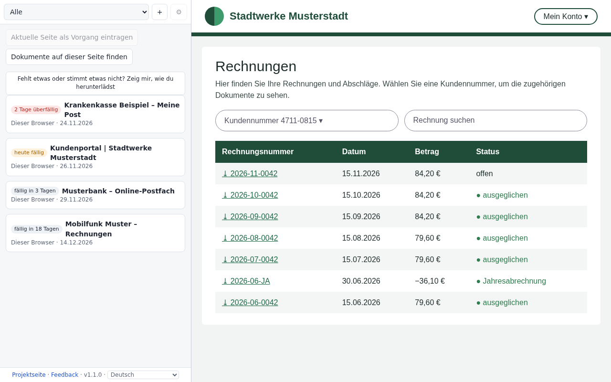

# Portal-Download browser extension

> [!IMPORTANT]
> **Warum es das gibt.** Rechnungen, Bescheide und Abrechnungen kommen bei vielen Unternehmen nicht mehr per Post oder E-Mail, sondern liegen nur noch in einem Portal, aus dem ich sie mir selbst holen muss. Das ist eine absolute Unart. Jedes Unternehmen hat sein eigenes Portal, ein einheitliches Verfahren gibt es nicht, und der einzige Grund, den ich mir dafür vorstellen kann, ist die Einbildung, so ließe sich die Zustellung beweisen. Mich nervt das gewaltig. portal-download löst das Problem nicht, es macht es für mich nur erträglicher, und zufrieden bin ich damit nicht. Die [GitHub-Diskussionen](https://github.com/schlingensiepen/portal-download-extension/discussions) sind offen und werden gelesen: Tragt dort bitte Erfahrungen, Wünsche, Verbesserungsvorschläge und Bugs ein.

> [!NOTE]
> **Why this exists.** Invoices, notices and statements from many companies no longer come by post or e-mail; they sit in a portal, and I have to fetch them myself. That is an utter bad habit. Every company has its own portal, there is no common procedure, and the only reason I can think of is the belief that this proves delivery. It annoys me enormously. portal-download does not solve the problem; it only makes it bearable for me, and I am not happy with it. The [GitHub discussions](https://github.com/schlingensiepen/portal-download-extension/discussions) are open and read: please post your experience, wishes, suggestions and bugs there.

The due portal downloads of every [Portal-Download](https://github.com/schlingensiepen/portal-download) service you belong to, and of a store in this browser, in one list in the browser's side panel. The portal opens in a normal tab beside it; the login is copied with one click; a run is closed as succeeded or failed.

For Chrome and Edge 121 or newer, and Firefox 140 or newer. A **backend** below is one source of jobs: a Portal-Download service, or the local store in this browser.

## Installing

The [releases](https://github.com/schlingensiepen/portal-download-extension/releases) offer two files per version:

- **`portal-download-<version>.xpi`, for Firefox:** download it, open `about:addons`, the gear menu, *Install Add-on From File…*, and choose it. Mozilla signed it.
- **`portal-download-<version>.zip`, for Chrome and Edge:** unpack it into a folder that stays, open `chrome://extensions` (Edge: `edge://extensions`), switch on *Developer mode*, *Load unpacked*, and choose the folder. The browser reminds you now and then that a developer extension is active, and may list two manifest keys it does not know (they are for Firefox); both are harmless.

Pin the toolbar button (the puzzle piece in Chrome and Edge, then the pin); it opens the side panel (Firefox: the sidebar).

**Permissions** the browser names when installing: *read your browsing history* comes from reading the address and title of the active tab, which the extension does only when you click **+** or *Add the current page as a job*; nothing else of your browsing is read or kept. Access to a service is asked for when you add it, for that service only.

**Updating:** these files do not update themselves. For a new version, download the new file: in Firefox install it the same way; in Chrome and Edge replace the folder's content and click the reload arrow on the extension's card. A service tells the extension when they speak different versions of the interface (a newer 0.9 service and a 0.8 extension, for example); the extension then reads the jobs but closes no runs until both match.

**Removing:** remove the extension in the browser's extension page. That deletes everything it kept in this browser. First remove each service under ⚙ (which also revokes the extension's access there), or revoke the device in the service's web application under **My devices**.

## Adding a service

1. Open an invitation link of the service in a tab, or, in the service's web application, *Add to the browser extension* under **My devices**, which opens such a link for you. It serves once, within the hour.
2. Click **+** in the panel and *Take the invitation from the current tab*.
3. Allow the extension to reach that service.

The extension gets a device access of its own, named after the browser and the system, which shows up among your devices in the service and can be revoked there.

**The computer must trust the service's certificate, before step 2.** Chrome and Edge do not count a certificate that was only accepted on a warning page. A service in the Portal-Download container image offers its certificate authority on its overview page and at `/ca.crt`: compare its fingerprint, then import it once as a trusted root certificate authority (on Windows: double-click the file, *Install certificate*; *Current user* needs no administrator, *Local machine* does; store *Trusted Root Certification Authorities*). Firefox takes the system's roots on Windows and macOS, otherwise import it under *Settings → Privacy & Security → Certificates → View Certificates → Authorities*.

## The list

**All** at the top shows the jobs of every backend in one list, most urgent first, each with the name of its backend. Choosing one backend shows its jobs only and enables what concerns that backend: *Add the current page as a job*, editing and deleting a job, and under ⚙ the exchange of jobs as a file and the backend's management (for a service: open its web application, remove it; for the local store: passphrase, lock, delete). Under **All** these are greyed out.

## The local store

Under **+**, *Keep jobs in this browser* creates a store of jobs in this browser only, encrypted with a **passphrase** of at least ten characters (the passphrase protects the store; a **password** below protects an exported file). From then on the tokens of the services lie under the passphrase as well, and the extension asks for it once after every start of the browser; *Lock now* under ⚙ locks it at once. Everything lies in the browser's storage for this extension, encrypted with the passphrase. Without a local store, the tokens of the services lie there unencrypted, as a browser keeps its cookies. **A forgotten passphrase cannot be recovered**: the unlock card then offers only to delete the store with its jobs and the services kept with it. Export the jobs now and then.

## Exchanging jobs

Under ⚙ of a backend, *Export the jobs* writes a ZIP file with every job, its login, its history and the deleted jobs, encrypted with AES-256 when you give a password (8 to 200 characters, no umlauts, no space at either end); without one the logins are in plain text and the extension asks first. *Read a file in* takes such a file from any Portal-Download service or from this extension: it first shows what would be taken over as new, what is the same, and where you decide, field by field, which side to keep (the newer side is chosen; for a due date the nearer one). No run is lost. Reading in copies: to move jobs, read them in on the other backend and then delete them where they were; a deleted job then stays deleted on both sides when files travel again.

## Privacy

The extension collects no data; requests go only to the services you add. Details in [PRIVACY.md](PRIVACY.md).

## Safari

Ich bitte um Verständnis, dass ich für ein kleines Hobbyprojekt nicht in das Apple Developer Program investiere. Ich habe aber gehört, dass Firefox und Chrome sehr gut auf Apple-Geräten laufen.

*Please understand that I am not paying for the Apple Developer Program for a small hobby project. I have heard, though, that Firefox and Chrome run very well on Apple devices.*

## Edge Add-ons

Wegen der Unbenutzbarkeit des Microsoft Partner Center musste der Eintrag bei Edge Add-ons leider verschoben werden. Bis dahin lädt Edge die ZIP-Datei aus den Releases wie Chrome.

*Because the Microsoft Partner Center proved unusable, the listing on Edge Add-ons had to be postponed. Until then, Edge loads the ZIP file from the releases, as Chrome does.*

## License

Apache License 2.0, see [LICENSE](LICENSE).
